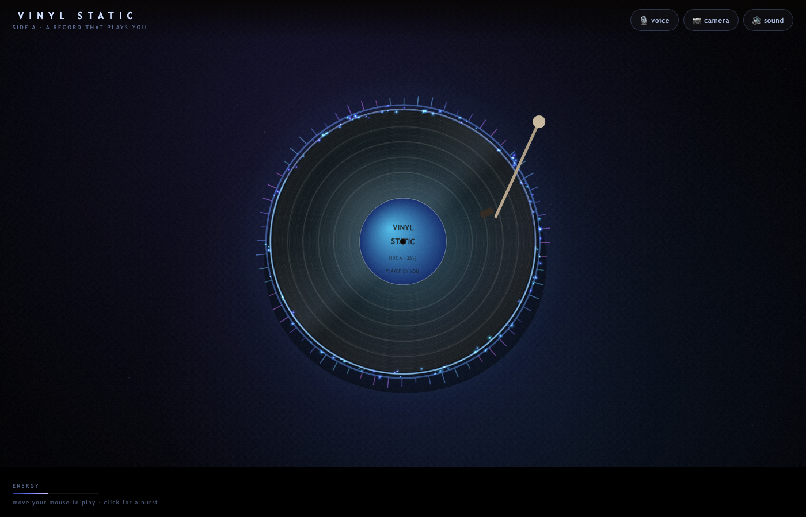

# VINYL STATIC 🎧

**▶ Play it live: https://yinzhulei333-lab.github.io/vinyl-static/** — https, so the microphone and camera work.

An interactive audiovisual instrument built for Assignment 3. A vinyl record sits in a black room; you shout at it or wave in front of the camera, and it answers with bursts of coloured sand, electromagnetic ripples and a live band — then everything stops the moment you do.

## The idea

- **Intended user:** anyone walking past a screen in a dark room — the piece is designed to be *discovered*, not learned. No instructions beyond one line.
- **What they can do:** shout, sing, clap, wave their hands at the camera, or move/click the mouse.
- **What happens:** the record spins faster, rainbow-of-cool-colour sand bursts out of the grooves, ripple rings expand, and a procedural rock band (distorted guitar, bass, drums, pad, arpeggio, lead) starts playing — the mix gets denser and brighter the louder you are.
- **The core rule:** interaction *is* the sound. Stop moving and the music fades out within ~0.3 s, the sand decays 3.4× faster, the record coasts to a stop. The piece is silent and still without a person.

## Screenshot



*Mid-interaction: spectrum ring, rim light and sand bursting from the grooves.*

## How to interact

| Input | Effect |
|---|---|
| 🎙 **Voice** (toggle) | Loudness drives sand emission, spin speed and band volume; the spectral centroid is used for the spectrum ring colours |
| 📷 **Camera** (toggle) | Frame-difference motion detection on a 64×48 offscreen canvas — your movement becomes bursts; nothing is recorded or uploaded |
| 🖱 **Pointer** | Always available: moving stirs the record, clicking fires a burst. This is the fallback when the sensors are unavailable |

Press **CLICK TO BEGIN** once — browsers require a gesture before audio can start.

## Implementation notes

- **No libraries, no audio files, no images.** Every visual is Canvas 2D; every sound is synthesized with the Web Audio API.
- **The band:** E minor progression (Em–C–G–D), each bar re-voiced: distorted power chords (two detuned sawtooths → tanh waveshaper → lowpass → reverb send), syncopated square bass, drum kit built from sine sweeps and filtered noise, sustained pad, 16th-note arpeggio, and a vibrato lead that only appears above ~60% energy. Convolution reverb uses a procedurally generated impulse response; a damped feedback delay sits on the arpeggio and lead.
- **The scheduler** is a look-ahead step sequencer (25 ms tick, 0.15 s horizon) so timing stays sample-accurate regardless of frame rate; tempo rises from 100 to 124 BPM with energy.
- **Performance:** all glow is drawn from pre-rendered sprites (no `shadowBlur`), the backdrop, disc, vignette and grain are cached offscreen, particles come from a 900-object pool, and quality degrades adaptively if frame times exceed 26 ms.

## How to run

No build step, no dependencies:

```bash
cd vinyl-static
python3 -m http.server 8000
# open http://localhost:8000
```

Microphone and camera require a secure context, so use `localhost` or the live https link — opening the file directly still gives you the pointer instrument.

## Error handling

- Sensor permission denied or device missing → a calm message, and the pointer instrument keeps working; the piece never looks broken.
- Sensor buttons are opt-in toggles; switching one off stops its MediaStream tracks immediately.
- Audio is only created after a user gesture (autoplay policy), so no silent failure on load.
- Simultaneous loud input is throttled to avoid runaway particle counts; the pool saturates instead of dropping frames.

## Known limitations

- Camera sensing is frame differencing, not pose tracking: it knows *where* motion is, not what your hands are doing.
- Very dim rooms reduce camera sensitivity.
- On low-end integrated GPUs the adaptive quality may drop the film grain and reduce particle counts.

## Credits

- All code, audio synthesis and visuals written from scratch for this assignment (AI assistance documented in PROCESS.md). No borrowed code, images, audio or datasets. Aesthetic references: turntablism, modular-light installations, generative art practice.
